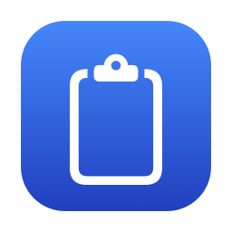
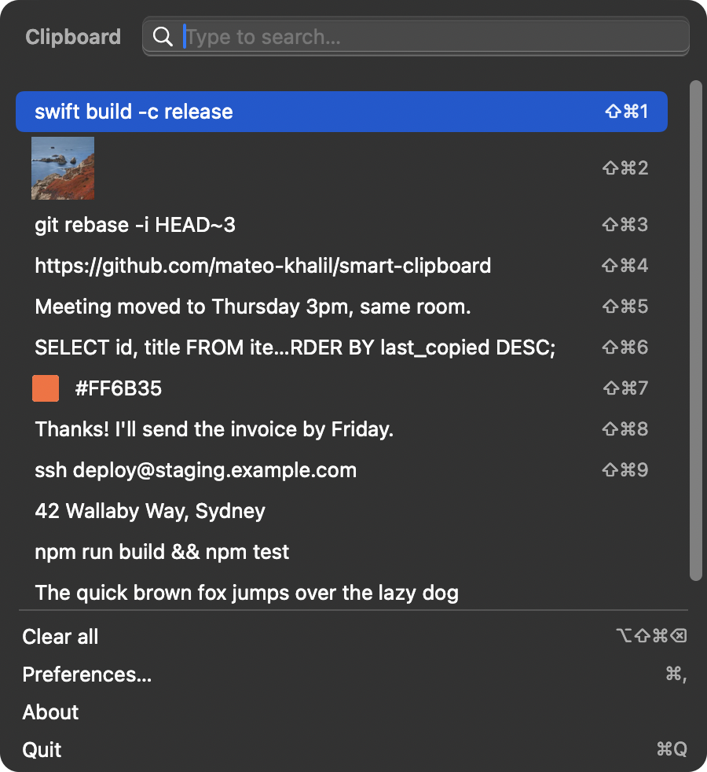
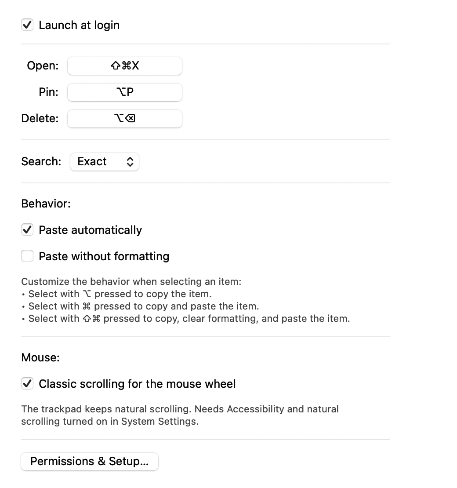
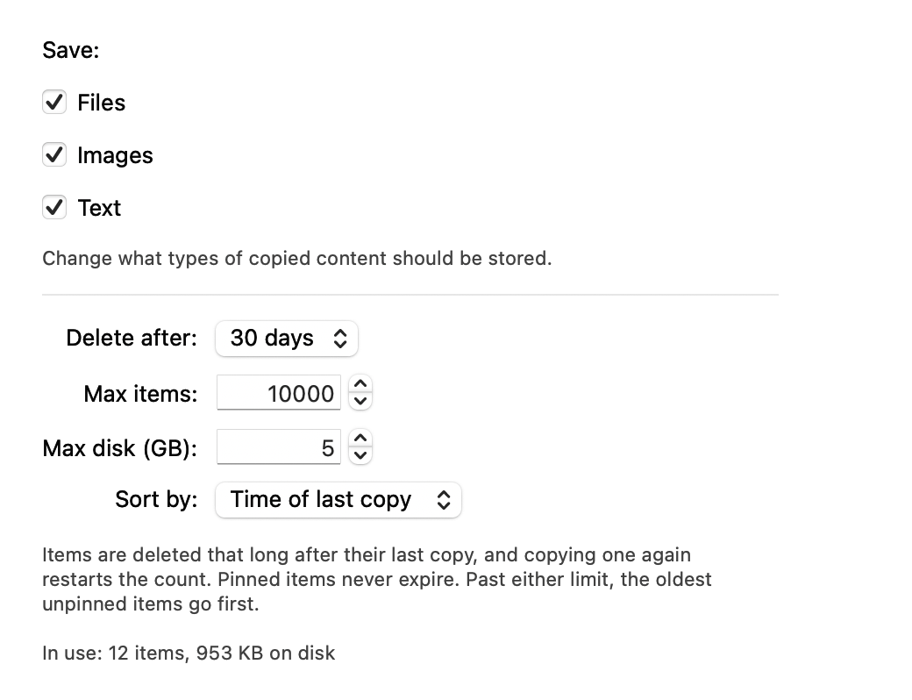

<p align="center">
  
</p>

<h1 align="center">SmartClipboard</h1>

<p align="center">
  <b>A native clipboard manager for macOS that uses ~22 MB of RAM. With 1,000 items or with 100,000.</b><br>
  Everything you liked about Maccy, rebuilt so your history lives on disk instead of in memory.<br>
  <i>New in 1.1: classic scrolling for your mouse wheel, natural scrolling for your trackpad, and side buttons that go back and forward in Safari.</i>
</p>

<p align="center">
  <a href="https://github.com/mateo-khalil/smart-clipboard/releases/latest"></a>
  
  
  
  <a href="LICENSE"></a>
</p>

<p align="center">
  
</p>

---

## New in 1.1: a mouse that scrolls like a mouse

macOS has **one** natural-scrolling switch for both the trackpad and the mouse. Natural feels right on a trackpad and backwards on a mouse wheel, so people end up installing a second app just to fix it.

SmartClipboard 1.1 does it for you. Turn on **Preferences > General > Classic scrolling for the mouse wheel** and:

- your **mouse wheel scrolls the classic way** (wheel down, page down),
- your **trackpad stays natural**, untouched,
- a Magic Mouse counts as a trackpad, since it scrolls like one.

It costs nothing: the same **22 MB and 0.0 % CPU** with it on or off, and no added delay per scroll. The event tap runs on its own thread and only listens for scroll events, so a busy moment in the app can never stall scrolling anywhere else. No extra app, no extra process.

The **side buttons** (4 and 5) get the same treatment with **Back and forward with the side buttons**. Chrome and Firefox already understand them; Safari, Finder, System Settings and the App Store ignore them. In those apps SmartClipboard turns the click into ⌘[ or ⌘], and everywhere else it lets the click through untouched, so an editor where ⌘[ means "outdent" never sees it.

<p align="center">
   General">
</p>

## Why

I used [Maccy](https://github.com/p0deje/Maccy) for years and liked it a lot. Then I noticed it was using **1 GB of RAM** to hold only 150 items, and it stayed there after I cleared the history down to a single item.

SmartClipboard does the same job, with the same shortcuts, in a fraction of the memory. The history is stored in SQLite and loaded one page at a time, so RAM doesn't grow with what you copy.

## The numbers

All numbers were taken on the same Mac (Apple Silicon, macOS 27) with `footprint`, which reports what macOS actually charges an app for memory. Activity Monitor's "Real Memory" (RSS) is misleading here: it showed Maccy at 15–30 MB while its real footprint was over 960 MB, most of it already pushed out to swap.

| | Maccy 2.6.1 | **SmartClipboard 1.1** |
|---|---|---|
| RAM, idle | 963–1067 MB with 150 items | **22 MB** with 1,000, 10,000 or 100,000 items |
| RAM, panel open | — | **26.5 MB** over 10,000 items |
| RAM, peak | 1324 MB | 105 MB, while trimming a 100,000-item history down to its cap |
| After clearing the history | still 1004 MB | back to idle |
| After 500 copies in a row | — | 32.7 MB, no growth |
| Daily use, after 17 days | — | 41 MB |
| CPU, idle | — | **0.0 %** |
| Panel open time | — | 27 ms median, 31 ms p95 (10,000 items) |
| Download size | — | 1.8 MB (universal DMG) |

Maccy's numbers come from one machine with real use and aren't a lab benchmark: a fresh Maccy install will use far less. The point is that its memory depends on what you copied and when. SmartClipboard's doesn't, and you can check that yourself with `scripts/measure.sh`, which loads throwaway histories of any size and measures them.

## How it stays small

- **The history lives on disk.** Items are rows in SQLite plus content files. The panel asks for one page of rows when it opens, and search streams through the database and stops early. Nothing keeps the whole history in memory.
- **The app never reads the clipboard itself.** Reading a 17 MiB image through `NSPasteboard` left 34 MB behind that no amount of releasing could recover: a `CFData` kept by the pasteboard and free blocks the allocator holds on to. So every read happens in `cliphelper`, a short-lived helper process that reads the pasteboard, makes the thumbnail, writes the files and exits. When it exits, macOS takes all of its memory back. A malformed clipboard item can crash the helper, but not the app.
- **Windows are created when they open and destroyed when they close.** Preferences and Setup don't sit in memory waiting for you.
- **Zero dependencies.** Swift, AppKit and SQLite from the system. No SwiftUI, no Electron, no frameworks. Global shortcuts use Carbon's `RegisterEventHotKey`, which doesn't need any permission.
- **Large items can't hurt it.** A 1 GB text copy, a 30 MB screenshot or a password manager entry are all tested in `scripts/e2e/hostile.sh`.

macOS has no notification for clipboard changes, so every clipboard manager has to check. SmartClipboard compares a single integer (`changeCount`) every 500 ms and only starts the helper when it changes. If it reads while another app is halfway through writing, it retries: without that, 3 out of 60 large copies were being lost.

## Features

- **Text, rich text, images and files**, with image thumbnails and a preview when you hover an item.
- **Search** in four modes: Exact, Fuzzy, Regexp, or Mixed (tries each in turn). Matches are highlighted.
- **Pins**: pin an item with ⌥P and give it a letter, then paste it any time with ⇧⌘ and that letter. Pins never expire.
- **Paste straight into the app you were using**, or just copy, or paste without formatting.
- **Privacy**: password managers' copies are always skipped (1Password, KeeWeb and anything that marks its copies as concealed or transient). You can also ignore apps, pasteboard types or text matching a regular expression, or record only the apps you list. ⌥-click the menu bar icon to pause.
- **Retention you control**: items are deleted a set number of days after their *last* copy (copying something again resets its clock), with a cap on item count and disk space. Optional clear on quit.
- **Import your Maccy history** in one click (Preferences > Advanced). It works on a copy and never writes to Maccy's files.
- **Same shortcuts as Maccy**, all customizable, plus position options (at the cursor, under the menu bar icon, centered, or where you left it).
- **Classic mouse wheel, natural trackpad** (new in 1.1, optional, Preferences > General). macOS has one natural-scrolling switch for both; turn this on and the mouse wheel scrolls the classic way (wheel down, page down) while the trackpad stays natural. A Magic Mouse counts as a trackpad. It needs Accessibility, and it does nothing while natural scrolling is off.
- **Mouse side buttons go back and forward** (new in 1.1, optional, Preferences > General) in Safari, Finder, System Settings and the App Store, which ignore them. Browsers that already handle them, and every other app, get the click untouched.
- **Setup window** on first launch that walks through permissions and launch at login.

<p align="center">
  
</p>

## Install

**[Download the latest DMG](https://github.com/mateo-khalil/smart-clipboard/releases/latest)**, open it and drag SmartClipboard to Applications.

The build is universal (Apple Silicon and Intel), signed with a Developer ID and notarized by Apple, so it opens without Gatekeeper warnings. Requires macOS 14 Sonoma or later.

On first launch, Setup asks for **Accessibility** permission. It's needed to paste into the app you're using (it sends a ⌘V) and for the mouse options; without it, SmartClipboard still records and copies.

Coming from Maccy? Quit it, then use **Preferences > Advanced > Import from Maccy…**.

### Build from source

```sh
git clone https://github.com/mateo-khalil/smart-clipboard.git
cd smart-clipboard
scripts/bundle.sh --install      # builds, signs and copies it to /Applications
open /Applications/SmartClipboard.app
```

Needs Xcode (Swift 6). The app is signed with the Apple Development certificate in your keychain (Xcode > Settings > Accounts creates one for free). Without one it's signed ad hoc, and macOS will ask for Accessibility again after every rebuild, because it ties that permission to the signature. If you have several certificates, pick one:

```sh
SIGN_IDENTITY="Apple Development: Your Name (TEAMID)" scripts/bundle.sh --install
```

## Shortcuts

| Action | Shortcut |
|---|---|
| Open the history | ⇧⌘X, or click the menu bar icon |
| Paste the selected item | ↩ |
| Copy without pasting | ⌥↩ |
| Paste without formatting | ⇧⌘↩ |
| Paste one of the first nine | ⌘1 … ⌘9 (⌥ to copy only, ⇧⌘ to strip formatting) |
| Pin an item | ⌥P, then paste it with ⇧⌘ and its letter |
| Delete an item | ⌥⌫ |
| Clear the history | ⌥⇧⌘⌫ twice (pins are kept) |
| Pause recording | ⌥-click the menu bar icon |

## Maccy vs SmartClipboard

Maccy is a great app, and SmartClipboard copies its behavior on purpose. This is what's different:

| | Maccy | SmartClipboard |
|---|---|---|
| History storage | SwiftData, managed by the app | SQLite, read one page at a time |
| Memory depends on what you copied | Yes, in our measurements | No: flat from 1,000 to 100,000 items |
| Reads the clipboard in | The app itself | A helper process that exits |
| Default history | 200 items | 10,000 items, 5 GB, 30 days |
| Expiry by age | No | Yes, counted from the last copy |
| Search modes | Exact, Fuzzy, Regexp, Mixed | Exact, Fuzzy, Regexp, Mixed |
| Pins, ignore lists, paste without formatting | Yes | Yes |
| Classic mouse wheel with a natural trackpad | No: needs another app | Built in, at no extra memory |
| Back and forward with the mouse side buttons in Safari | No: needs another app | Built in, at no extra memory |
| Translations | Many languages | English only |
| Mac App Store / Homebrew | Yes | Not yet: DMG or source |

If memory isn't a problem on your Mac, Maccy is a perfectly good choice. If you've ever found your clipboard manager near the top of Activity Monitor, try this one.

## Architecture

```
Sources/
  ClipCore       models, filters, search and the capture pipeline (no AppKit, unit-tested)
  ClipStore      SQLite history and content files in ~/Library/Application Support/SmartClipboard
  ClipPlatform   pasteboard, global hotkey, paste, mouse tap and macOS services
  ClipUI         the panel, Preferences and Setup
  cliphelper     the short-lived process that reads the clipboard and writes large pastes
  clipbench      search, paging and cleanup benchmarks
```

### Design decisions not to undo

- **The main process must not read the pasteboard.** That's what keeps idle memory flat. Every read goes through `cliphelper`.
- **Measure with `footprint`, never RSS.** RSS hides swapped and compressed memory.
- **Signing must stay stable.** macOS ties the Accessibility permission to the signature, so changing it means granting the permission again.
- **Nothing runs while idle** beyond the `changeCount` check.
- **The mouse tap stays on its own thread and only asks for the events its options need** (scroll, and buttons 3 and up). On the main thread, any busy moment in the app would stall scrolling in every app. Idle, the thread sleeps in the kernel: same 22 MB and 0.0 % CPU with or without it, and no added delay per event. It flips only discrete (wheel) events, and writes the point delta last from its original value, because setting the line delta makes macOS recompute it with acceleration. Side buttons are translated only in an allowlist of apps (`MouseTap.navigationApps`): a blanket ⌘[ would outdent code in editors, and Chrome would go back twice.

## Development

```sh
export SDKROOT=$(xcrun --sdk macosx --show-sdk-path)
swift test                                   # logic and storage
swift run -c release clipbench               # search, paging and cleanup timings
scripts/measure.sh                           # idle RAM by history size (quit the app first)
scripts/e2e/hostile.sh <large-image.png>     # extreme copies
scripts/e2e/race.sh <large-image.png>        # lost copies
scripts/e2e/run.sh                           # real keys and clicks; hands off for ~40 s
```

The measurement and e2e scripts use a throwaway history, but they quit the app and write to the clipboard (`hostile`, `race` and `run` restore plain text only).

### Releasing

`scripts/release.sh` builds the universal app, signs it with Developer ID, packs the DMG, notarizes it, staples the ticket and runs the same Gatekeeper checks a downloaded copy goes through. It needs a **Developer ID Application** certificate (Xcode > Settings > Accounts > Manage Certificates) and notarization credentials stored once with `xcrun notarytool store-credentials smartclipboard --apple-id <apple id> --team-id <team id>`. `scripts/release.sh --dry-run` checks the packaging with any local certificate, without notarizing.

## Contributing

Issues and pull requests are welcome. Please keep the spirit of the project: no dependencies, no work while idle, and a measurement with `footprint` for anything that might change memory use.

## License

[MIT](LICENSE) © 2026 Mateo Duran. Not affiliated with Maccy; thanks to [@p0deje](https://github.com/p0deje) for the app that inspired this one.
